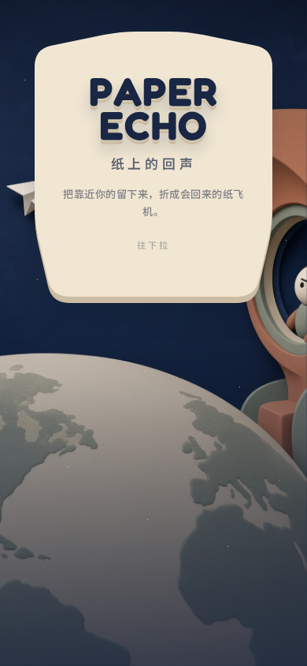
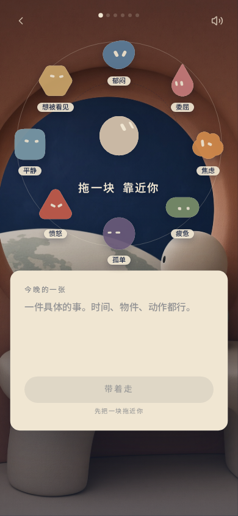
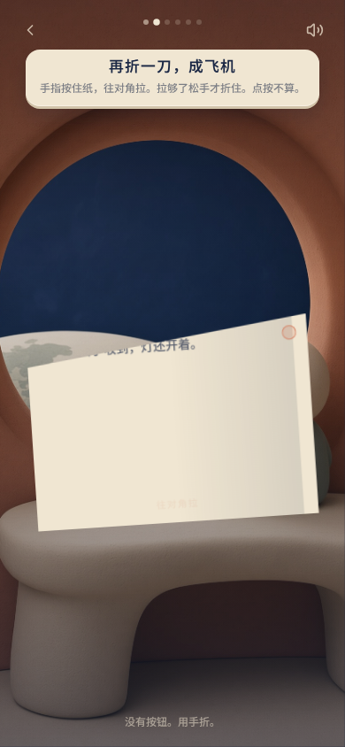
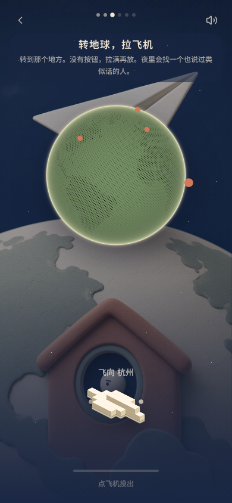
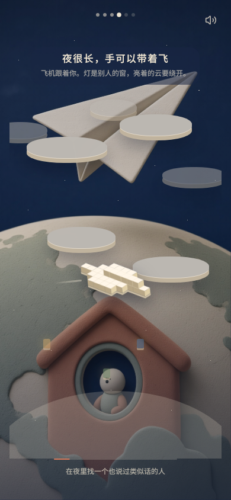
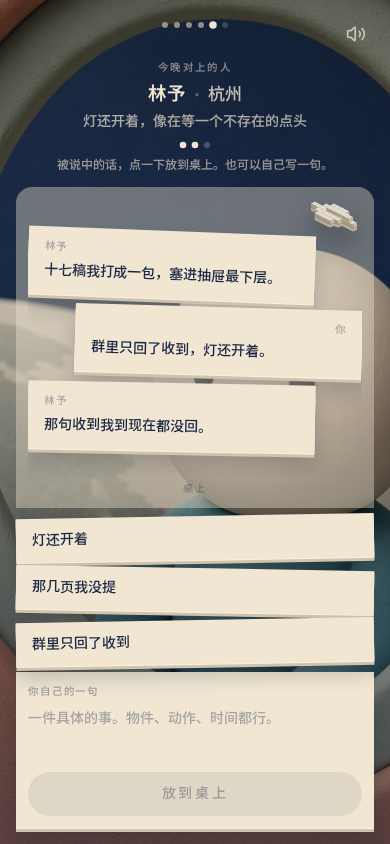
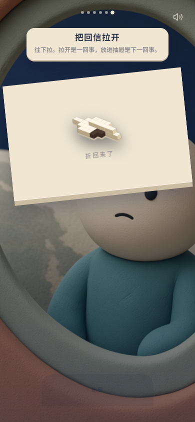
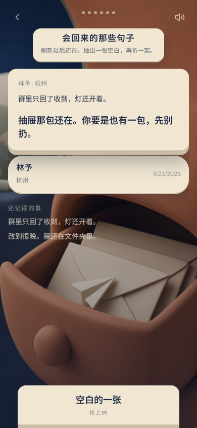

# 纸上的回声 · 游戏逻辑与功能板块预览

> 只写代码看不出来的：一晚上想让玩家经历什么、每一步为什么这样、哪些已拍板、哪些还悬着。阶段、阈值、字段、链路以代码为准（入口 `src/game/store.ts`、`src/game/phases/`）。  
> 本文只描述现状，不改玩法口味。

---

## 0. 一晚上在干什么

玩家不先点「我很焦虑」。用手把靠近自己的情绪拖近中心，写下今晚那句说不出口的话，这张纸直接折成飞机，掷向世界某处。对面是一个深夜没睡的普通人：只说自己今晚的具体事，不安慰、不分析、不替你下结论。桌上用自己的真细节换对方故事的下一层。聊够了，玩家自己把今晚折回去，对方回一封信。信柜墙上钉下这一晚，以后还能再去找同一个人。

| 命题题眼 | 这局里怎么落地 |
|---|---|
| **识别** | 情绪离中心越近，越算「认领」。玩家看见的是生物脸和「今晚的画像」，不是百分比。 |
| **回应** | 回声只讲自己的平行经历。回应 = 被看见，不是被安慰。 |
| **推动一次更好的沟通** | 玩家必须先交出自己的一句（轨道写句 → 桌上再交真细节），才能换到对方故事的下一层。 |

**不是什么**：不是心理咨询、不是树洞机器人、不是交友匹配；无好友、无关注、无真实即时通信。

- 推进一步靠拖 / 折 / 拉 / 松开。允许直接点的例外：轨道「带着走」、桌上「放到桌上」「把今晚折回去」、飞行中「不找了，回地球」。
- 纸 → 飞机 → 回信，是一件东西在变形。
- 找人途中可以放弃重掷；一旦对上人，就不能回头。
- 没有模型钥匙、或任一链超时，玩家仍能从标题走到信柜。

---

## 1. 功能板块预览

> 静帧（`docs/previews/`）拍于旧版：多数画面的引导文案已改，相遇桌和信柜的布局也变了，以实机为准。重拍用 `scripts/preview-modules.mjs`。

### 1.1 title · 进房间

- **看见**：一张纸卡，`PAPER` / `ECHO` 错开弹出。第一次进来，纸上多印一句行动和一句铁律。有过局，底部多一个信柜抽屉。
- **手**：整张卡往下拉，松开进房间；抽屉另拉，开信柜。

### 1.2 orbit · 摆情绪 + 写下今晚那句

- **看见**：中心是「你」，周围 8 张情绪脸。拖近的会醒，「你」的颜色跟着混。纸上写今晚那句，写够几个字后出现「今晚的画像」：靠近的情绪 + 那句原话。
- **手**：把靠近自己的拖进白圈；写完点「带着走」，或把纸往下拉。至少拖近一块、写下一句才放行。
- **为什么**：不让玩家选标签。拖近比点「我很焦虑」更像认领。

### 1.3 fold · 纸上就是那句，折成飞机

- **看见**：一张还能读到字的纸，字就是轨道上写下的那句。折两次成飞机，窗外有一道光。
- **手**：捏住纸角往对角拉，拉够松手折住；两次后按住飞机往上送到窗边。
- **口径**：拼碎片已拿掉，写完直接折，信就是那一句。

### 1.4 throw · 转地球 + 弹弓

- **看见**：飞机穿过窗飞进地球，灯一盏一盏开——灯是别人的窗。地球在转，面向哪个区域，文案就跟到「飞向 {城}」。
- **手**：转地球；在弹弓上把飞机拉满再放。

### 1.5 flight · 夜里找人

- **看见**：飞机自己在云里巡航，上方是「寻找世另我ing」字标和已等秒数。找到后：「到了 {城}，{名} 读完了你的信」。匹配失败或超时，换成兜底文案，对面换成本地故事卡。
- **手**：等。等不下去可以「不找了，回地球」重掷。找到后把飞机往下拉，落到桌上。
- **口径**（2026-08-23）：寻找中只巡航等待，无跟飞、无躲障。

### 1.6 encounter · 桌上换故事

- **看见**：「今晚对上的人 {名} · {城}」，下面三颗点表示对方的故事说到哪（发生的事 → 当时的感觉 → 后来改了什么），不出现层号。桌上叠着当晚的纸，对方先开口。三颗点下面一句引导，告诉你他接没接到。
- **手**：在「你自己的一句」里写一件具体的事，点「放到桌上」。聊够了，点两下「把今晚折回去」。
- **为什么**：用自己新的、具体的真事换对方故事的下一层；空话不罚、不弹失败，故事只是往下走得慢。没有固定轮数，什么时候收由玩家决定。规则见 `docs/echo-spec.md` §2。

### 1.7 return · 拆回信

- **看见**：飞机落下，「折回来了」，变成一封未拆的信。拉开读对方的回信；再往下，信被抽屉吞进去。
- **手**：往下拉一次拆开，拉深一点归档。

### 1.8 archive · 信柜

- **看见**：一面钉着纸条的墙。每一晚一张，最新的是带签名的信封；旁边几张「还记得」的小纸。点开一张，读那一晚的对话。
- **手**：底部「空白的一张」往上抽，开始新的一晚。读着某一晚时，同一处变成「再去找他」，往上抽就再去找同一个人。
- **再见面**：对方不是停在原地等你，会带着这几天自己过的日子开口。

---

## 2. 系统板块

- **回声系统面板（按 J）**：给评委看的透明盒。模型没出字时，路径要老实显示「本地信柜」，不空盖「实时链」。
- **世界档案**：采集的原文只留本地 `corpus/`，不入库、不进游戏；游戏里只用改写稿。

---

## 3. 还没拍板、本文不发明

1. **throw 选区的意义还偏弱**（区域在匹配里只加分，不是硬过滤）。
2. **链吐的真句子还没在桌上核对过**：上次真跑（2026-08-23）钥匙失效，桌上全是本地故事卡。有效钥匙到位后，用 `scripts/probe-encounter.mts` 再对一次桌上句子。
3. **残留字段**：store 里的碎片字段、链返回里的 suggestions，界面都已不用，是否清掉另说。
4. **命题张力**还没当作对外口径定稿。
5. **世界档案北星**未获最终确认：「A 活档案为主 + C 玩家入池为增长 + B 精选源并入 A」。

---

## 4. 已拍板的口径（不要重复问）

1. **流水线方向**：演示 = 离线预采集安全垫；产品北星 = 活信息流，不能被硬编码限定。匿名化改写必须用 prompt 做；爬虫是内容生产工具，不是运行时主角。
2. **Agent 身份表述**：真实普通人感，不要场景剧场腔。「窗边」只是给玩家看的场景，不是让 Agent 念的台词。
3. **协作**：任何涉及产品口味的改动，先确认再动手。
